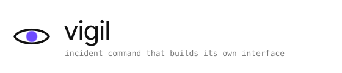
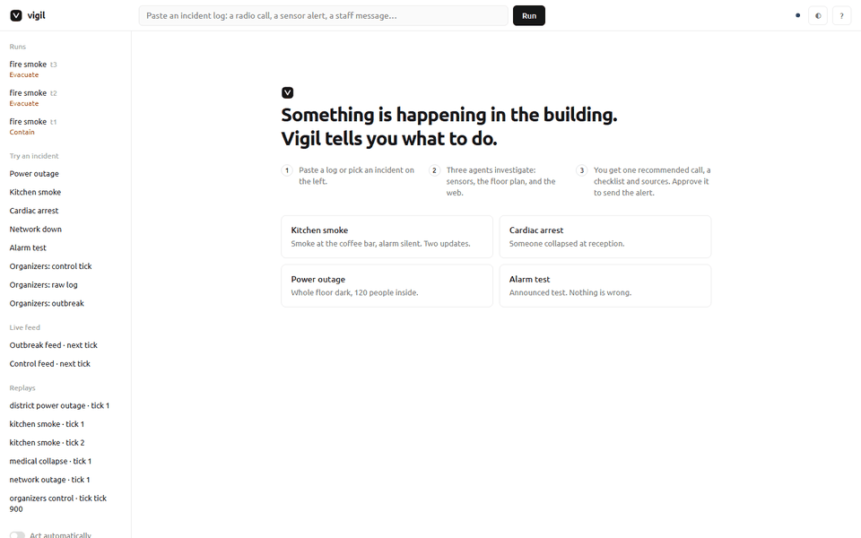
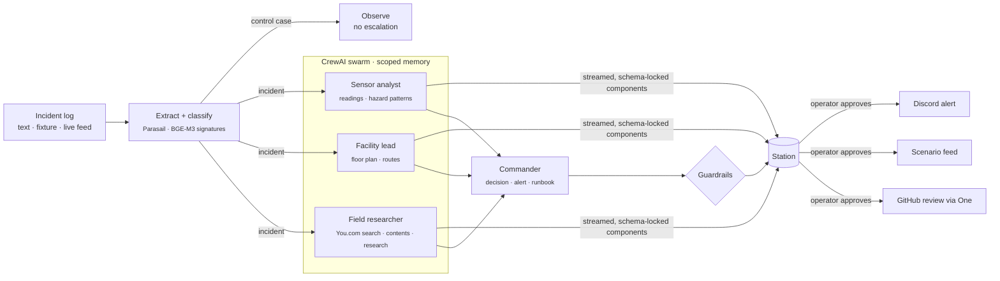
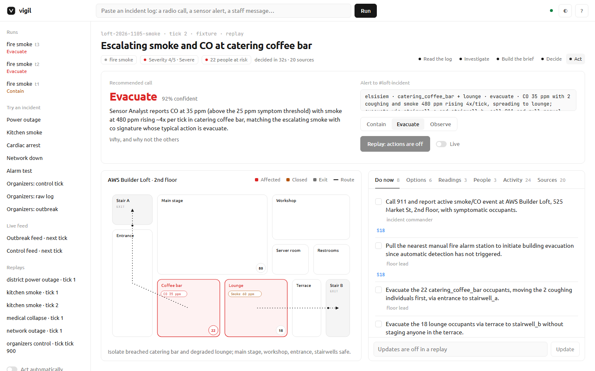
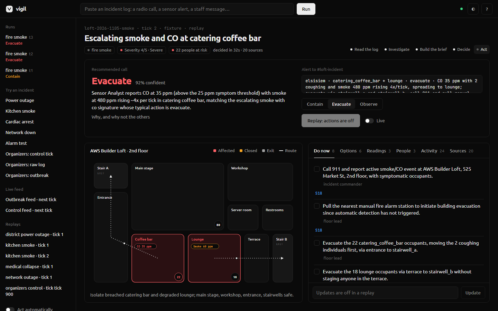
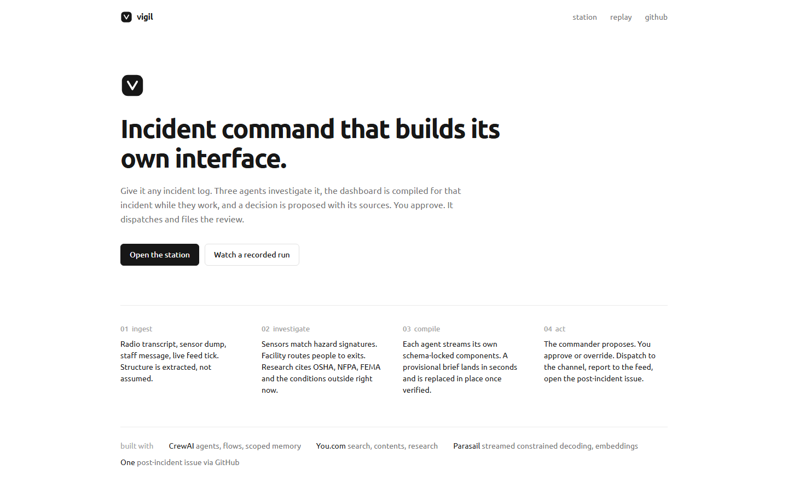
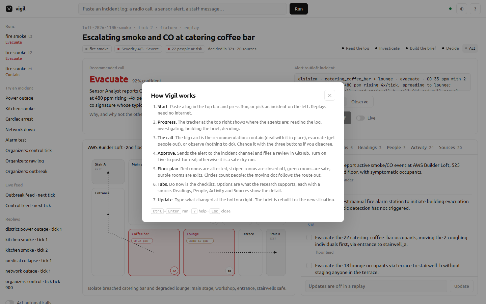

<p align="center">
  <picture>
    <source media="(prefers-color-scheme: dark)" srcset="docs/assets/banner-dark.svg">
    
  </picture>
</p>

<p align="center">
  <a href="https://vigil-station.fly.dev">Live station</a> ·
  <a href="https://vigil-station.fly.dev/app?replay=kitchen-smoke-tick-2">Recorded run</a> ·
  <a href="#run-it">Run it</a> ·
  <a href="docs/demo-script.md">Demo script</a>
</p>

<p align="center">
  
  
  
</p>

<p align="center"></p>

Vigil turns any incident log into an operating brief. Three agents investigate in parallel, the interface is
compiled for that incident while they work, and a commander proposes one call (contain, evacuate or observe) with a
cited checklist. The operator approves; Vigil posts the alert, reports to the feed and files the review.

## Problem

Incident tools are configured before the incident: fixed panels, fixed runbooks, fixed thresholds. When the event is
not the one that was planned for (smoke with the alarm silent, a cardiac arrest at reception, a district power cut
during a full house) the operator reads raw logs and improvises. The information exists. It is not arranged for the
decision at hand.

## How it works



1. **Ingest.** Parasail extracts sectors, readings, people and state from free text into a fixed schema.
2. **Classify.** Readings are matched against a hazard-signature library (BGE-M3 embeddings) and a schema-locked
   triage call sets class, severity and people at risk. Announced tests and nominal readings exit here as *observe*.
3. **Investigate.** Three CrewAI agents with separate tools and separate memory scopes:
   the *sensor analyst* (readings, witness reports, signatures), the *facility lead* (floor plan, capacities, exit
   routes) and the *field researcher* (You.com Search with highlights, Contents, and Research with an output schema).
4. **Compile.** Each agent owns a slice of a typed component catalog. Parasail streams a schema-locked manifest; the
   browser mounts each component as its closing brace arrives. A draft from raw readings renders within seconds and
   is replaced in place once verified.
5. **Decide.** The commander reads the three reports and a read-only memory slice, then writes the call, the alert
   line and a runbook. Deterministic guardrails apply: people in a breached sector are never left under observation,
   control cases are never escalated, infrastructure faults with nobody at risk are contained.
6. **Act.** On approval the station posts to `#loft-incident`, submits to the scenario feed when the incident came
   from it, and opens a post-incident issue in GitHub through One.
7. **Update.** An operator note becomes the next tick; the brief is rebuilt.

Citations are assembled by the system from the grounding calls that happened. A model cannot add one.

## Partners

| | Role in Vigil | Without it |
|---|---|---|
| **CrewAI** | Flow with a deterministic router; three agents with their own tools and iteration budgets; unified Memory with per-agent scopes and a read-only slice for the commander, persisted across incidents. | No investigation, no partial knowledge, no memory. |
| **You.com** | All outside facts: Search with highlight extraction, Contents, Research with an output schema (cited JSON in one call), fresh local conditions. The scenario feed is read over MCP. | No citations. |
| **Parasail** | Every model call: strict `json_schema` with `anyOf` component unions, streamed; thinking disabled per model for bounded latency; BGE-M3 embeddings for signatures and memory. | No schema-locked components, no streaming. |
| **One** | Files the post-incident review to GitHub through an authorised connection, CLI in agent mode. | No after-action record. |

## Screens

<table>
  <tr>
    <td></td>
    <td></td>
  </tr>
  <tr>
    <td></td>
    <td></td>
  </tr>
</table>

## Run it

```bash
git clone https://github.com/elsisiem/vigil && cd vigil
make setup          # venv, dependencies, .env from .env.example
make serve          # http://127.0.0.1:8787
```

Windows without make:

```powershell
py -3.12 -m venv .venv; .\.venv\Scripts\python.exe -m pip install -e ".[dev]"
copy .env.example .env
.\.venv\Scripts\python.exe -m vigil serve
```

| Command | Does |
|---|---|
| `make run F=kitchen-smoke` | One fixture in the terminal, event by event |
| `make feed` | Plays the organizers' scenario feed for your team (dry run unless `VIGIL_DRY_RUN=0`) |
| `make eval` | Decision accuracy, false alarms, latency, schema validity, citation coverage |
| `make test` | Offline unit tests |
| `make offline` | No network: recorded runs replay with original timing |

Requires Python 3.10 to 3.13 and, for the GitHub review, Node 22.23.4+ (One CLI). Keys go in `.env`:
`YDC_API_KEY`, `PARASAIL_API_KEY`, `ONE_SECRET`, optional `DISCORD_WEBHOOK_URL` and `TEAM_HANDLE`.

## Inputs

- **Text.** Any log. Structure is extracted; an unknown facility gets a generated layout.
- **Fixtures.** Network outage, kitchen smoke (two ticks), cardiac arrest, scheduled alarm test (control), district
  power outage, plus the organizers' three files, unmodified.
- **Live feed.** The organizers' MCP scenario feed. Ticks become the same incident model as text.
- **Replay.** Every run is recorded as an event stream and replays without network or keys.

## Layout

```
vigil/
  catalog.py     typed component catalog → strict JSON schemas, per-agent unions
  facility.py    floor plan graph, routing, generated layouts
  ingest/        fixtures, MCP scenario feed
  grounding/     You.com client (cached)
  inference/     Parasail client (schema-locked, streamed, embeddings), streaming JSON parser
  swarm/         agents, tools, memory, signatures, flow, guardrails
  actions/       Discord webhook, One client, after-action composer
  server/        FastAPI + WebSocket, static station (no build step, fonts bundled)
  eval/          harness behind make eval
```

## Limits

- The AWS Builder Loft plan is a model, not a survey.
- The hazard-signature library is small and hand-written.
- The research brief is the slowest step (about ten seconds) and the one that makes the runbook citable.
- Memory persists per machine; the hosted instance resets on redeploy.

## License

MIT. Fonts: Ubuntu (Ubuntu Font Licence) and JetBrains Mono (SIL Open Font License).
